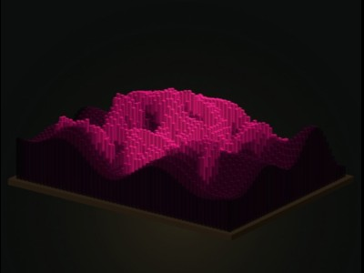
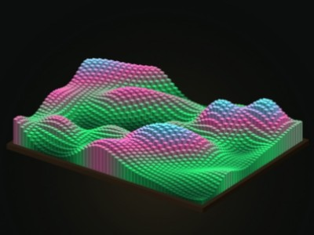
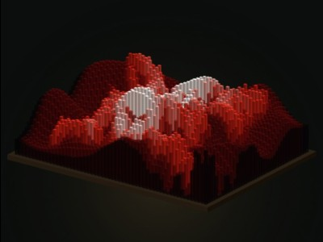
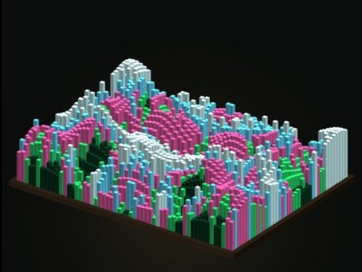
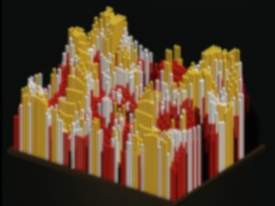

# X3-B Sound Visualizer

    

**Try it live: [https://infinite-void.github.io/Sound_Visualizer/](https://infinite-void.github.io/Sound_Visualizer/)**

## What it is

A sound visualizer that turns audio into a heightmap — a terrain map made of sound. A board of 56 × 42 pins rises and falls with the sound, driven by frequency analysis: each band drives part of the grid through a Fast Fourier Transform.

## How to use

1. Open the page. The board is already alive
2. Pick an audio source 
3. Pick a pattern and a color set. 
4. Adjust Gain, Fade, and Contrast to taste.

## Audio sources

There are five sources. What each one can hear is different.

| Source | What it does | Works where |
| --- | --- | --- |
| Ambient | Procedural waves, generated in the page. Alive on load, no audio needed. | Everywhere |
| Demo beat | A built-in 112 BPM loop — synthesized bass, pluck, and hats. | Everywhere |
| Microphone | Listens to the room through your microphone. | Where a microphone is available — speakers only, see below |
| Audio file | Plays files you upload, in order, as a playlist. | Everywhere, including phones and with headphones |
| Tab audio | Captures the audio from another browser tab. | Desktop Chrome only — see below |

### Ambient

Ambient mode needs no input at all. It generates slow procedural waves so the board moves as soon as the page opens, and so you can try patterns, color sets, and controls without finding a sound first.

### Demo beat

Demo beat is a self-contained synthesized loop at 112 BPM: bass, a pluck melody, and hats. Like Ambient, it works everywhere, with no file, microphone, or second tab involved.

### Microphone

Microphone mode analyzes whatever your microphone picks up. Whether it's people talking or your favorite music playing over speakers.

### Audio file

Upload audio files and the board analyzes them as they play, in order, as a playlist. 

This is a reliable way to use the visualizer with headphones — on any device, including phones.

### Tab audio

Tab audio lets the visualizer listen to music playing in another browser tab: music in one tab, visualizer in another. * this is the only way to use streaming services with the visualizer.

1. Start the music in its own tab.
2. In the visualizer, select Tab audio as the source.
3. In the share picker that appears, choose the music tab and share its audio.
4. That tab's audio now feeds the board. Stop the share and the visualizer drops back to ambient.

It works with headphones. Capture happens inside the browser, before the sound reaches your headphones or speakers, so the microphone is not involved at all.

## What works where

| Setup | Ambient | Demo beat | Audio file | Microphone | Tab audio |
| --- | :---: | :---: | :---: | :---: | :---: |
| Desktop Chrome | Yes | Yes | Yes | Yes, with speakers | Yes |
| Desktop Firefox | Yes | Yes | Yes | Yes, with speakers | No |
| Desktop Tor | Yes | Yes | Yes | Yes, with speakers | No |
| Phone browser | Yes | Yes | Yes | Yes, with speakers | No |

### Tab audio: desktop Chrome only

Tab audio works in desktop Chrome.

It does not work in Firefox or Tor — they provide no tab audio.

It does not work in phone browsers.

### Headphones, summarized

- Audio file: works with headphones, everywhere.
- Tab audio: works with headphones, on desktop Chrome.
- Demo beat and Ambient: generated in the page, so headphones make no difference.
- Microphone: does not work with headphones. It needs speakers, out loud.

## Streaming services

There is no direct connection to Spotify, YouTube, Apple Music, or any other streaming service, and there is no Spotify integration.

Workaround on desktop Chrome: play the music in one tab and capture that tab's audio in the visualizer tab using Tab audio.

## Patterns

Patterns decide how the board is drawn. 

- **Skyscrapers** — tall, free-standing rectangular bars with real gaps between them. No waterfall effect.
- **Rolling** — the pins stay in place while a wave rolls through the board. Waterfall is off in this mode.
- **Rorschach** — a full-width left-right mirror: the left half is reflected onto the right.
- **Inverse** — heights and colors are flipped. High becomes low, and the color ramp runs the other way.
- **Ember Blot** — a blot pattern. It follows the picked color set, like Breakup — changing the color set recolors it completely.
- **Breakup** — a high-contrast shard pattern, for maximum breakup on dense material.

Pattern buttons can run solo or stacked. Pick one on its own, or turn on more than one — the buttons combine rather than switching one at a time.

For example, **Skyscrapers + Rorschach*** runs Skyscrapers as the base pattern with the Rorschach mirror stacked on top of it.

Ember Blot and Breakup work the same way. Picking one sets the board's look: it swaps in its own pin design rather than stacking on Skyscraper bars, replacing the other thumbnail pattern, and clicking it again clears it. The Rorschach mirror, by contrast, stacks on top of a base pattern such as Skyscrapers.

## Color sets

There are five color sets:

- Blue / pink / green
- Red / white / gold
- Violet / gold
- Red / black / white / gold
- Black / pink / white (white peaks)

Color sets and patterns are fully decoupled:

- Any color set works with any pattern.
- Picking a pattern never changes your color set, and picking a color set never changes your pattern.

## Controls

There are three sliders. 

- **Gain — sensitivity.** How hard the sound pushes the pins. Turn it up for quiet sources, down for loud ones that pin everything to the top.
- **Fade — decay.** How fast the bars fall back, and how long motion lingers after a sound passes. Low Fade drops quickly; high Fade leaves a longer trail.
- **Contrast — breakup.** The maximum difference between highs and lows. Peaks go higher and valleys go lower while the floor stays put, giving more breakup — more separation between the tall parts and the flat parts.

Hide controls collapses the whole panel. A floating Show controls pill remains on screen to bring it back, so you can watch the board with nothing over it.

## Phones

The visualizer runs on phones, with these limits:

- Audio file upload works on phones, and it works with headphones — this is the main way to visualize your own music on a phone.
- Ambient and Demo beat work on phones, as they need no input.
- Microphone mode works, subject to the headphone limit above: it hears the room, so the sound needs to be out loud.
- Tab audio does not work on phones, in any mobile browser.
- A backgrounded tab freezes the picture. Browsers pause the page's drawing when the tab is not in front, so keep the visualizer tab visible while it plays.

## Common questions

**Can I plug Spotify straight into it?**
No. On desktop Chrome, play it in one tab and use Tab audio in the visualizer tab.

**Tab audio is not working in Firefox or Tor.**
Use desktop Chrome for Tab audio.

**Tab audio is not working on my phone.**
Use Audio file, Ambient, or Demo beat.

**Microphone mode is ignoring my music.**
Play it through speakers, or use Audio file or Tab audio.

**Where is the Height slider?**
There is not one. Use Gain.

**Can I use any pattern with any colors?**
Yes. Pick any combination.
